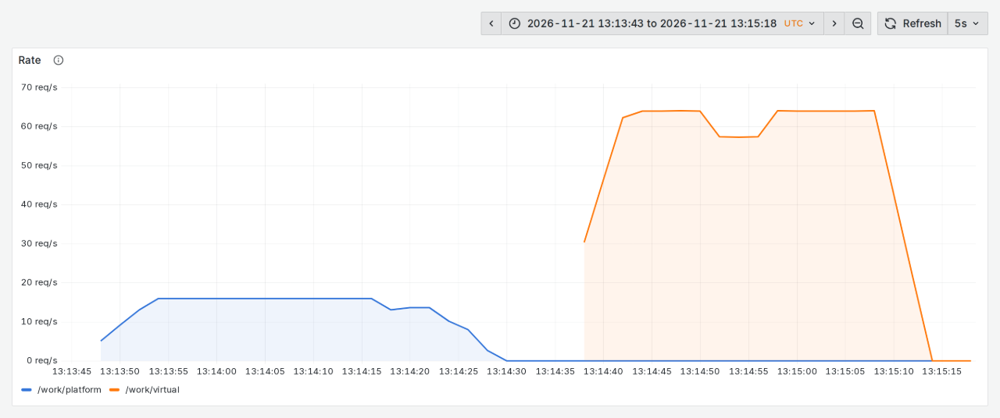
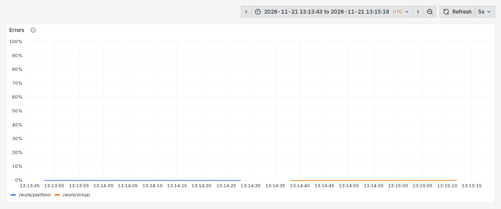
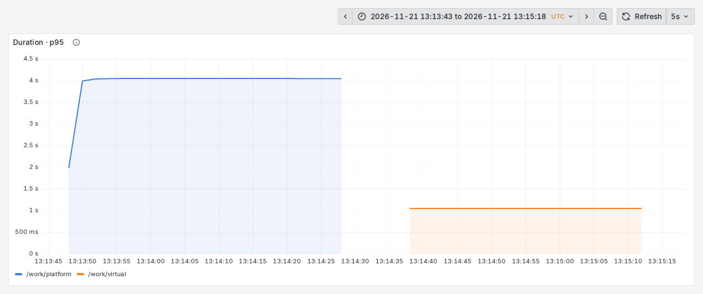

# Пропускная способность HTTP-запросов и мониторинг RED

При 64 параллельных клиентах платформенные потоки обработали **16,00 запроса/с**, а виртуальные — **63,99 запроса/с**. В данном эксперименте виртуальный исполнитель обеспечил примерно **в 4 раза** большую пропускную способность.

## Методика и замеры Actuator

`http.server.requests` учитывает завершённые HTTP-запросы и время их обработки. Измеряли изменение накопленного `COUNT` за 10 секунд. Пропускная способность показывает, сколько ответов приложение успевает обработать за секунду при заданной нагрузке. По накопленному значению `COUNT` без второго показания скорость определить нельзя.

Оба метода выполняли одинаковую работу — `Thread.sleep(1000)` имитировал ожидание ответа внешнего сервиса. `/work/platform` использовал фиксированный пул из 16 платформенных потоков с очередью, `/work/virtual` создавал виртуальный поток на запрос. Одиночные проверочные запросы заняли 1,025 и 1,007 с соответственно. Флаг `virtualThread` в ответе подтвердил фактический тип потока.

В каждом прогоне 64 клиента отправляли следующий GET сразу после получения предыдущего ответа. После 12 секунд прогрева скрипт прочитал `COUNT` на `/actuator/metrics/http.server.requests` с фильтрами `tag=uri:<маршрут>` и `tag=method:GET`. Через 10 секунд при продолжающейся нагрузке он прочитал значение повторно. Эти фильтры исключили запросы Actuator и опросы Prometheus из замеров.

| Потоки | COUNT в начале | COUNT в конце | Завершено | Интервал, с | Запросов/с |
| --- | ---: | ---: | ---: | ---: | ---: |
| Платформенные | 177 | 337 | 160 | 10,002 | 16,00 |
| Виртуальные | 705 | 1 345 | 640 | 10,001 | 63,99 |

Расчёт — `(COUNT₂ − COUNT₁) / Δt`. В таблице интервал округлён до миллисекунд. Исходные показания и ответы клиентов сохранены в [actuator.json](evidence/actuator.json).

## Графики Grafana

Prometheus собирал метрики с `/actuator/prometheus` каждые 2 с. Дашборд использует 8-секундное окно PromQL и отображает обе серии на общей шкале времени. Синий цвет соответствует `/work/platform`, оранжевый — `/work/virtual`. Замеры проведены 21 ноября 2026 года.

### Rate

Скорость завершения запросов держалась около **16 запросов/с** в платформенном режиме и **57–64 запросов/с** в виртуальном. `rate()` оценивает скорость по выборкам Prometheus за скользящее окно, поэтому отдельные точки могут отличаться от результата по двум показаниям Actuator. [Функция rate в документации Prometheus](https://prometheus.io/docs/prometheus/latest/querying/functions/#rate)



### Errors

Доля HTTP 4xx и 5xx составила **0%** в обоих прогонах. Клиенты получили 560 и 2 048 ответов HTTP 200 соответственно за весь период нагрузки с прогревом и ожиданием последних ответов. Разрыв между сериями соответствует паузе без нагрузки.



### Duration

Оценка **p95** составила около **4,05 с** для платформенных потоков и **1,05 с** для виртуальных. p95 оценивает длительность, в которую уложились 95% запросов. Таймер включает ожидание в очереди, поэтому при 64 клиентах и 16 занятых платформенных потоках часть запросов ждала освобождения рабочего потока. У виртуального исполнителя отдельный поток создавался для каждого запроса, и длительность оставалась близкой к заданной секунде. [Документация Prometheus по histogram_quantile](https://prometheus.io/docs/prometheus/latest/querying/functions/#histogram_quantile)



[Численные значения графиков внутри окон замера](evidence/prometheus.json).

**Ограничение сравнения.** Результат относится к нагрузке с ожиданием и выбранным настройкам исполнителей. Размер платформенного пула, число клиентов и характер работы влияют на итоговое соотношение.

## Инструменты

- JDK Amazon Corretto 21.0.13.1, Maven 3.9.11 и Spring Boot 3.5.9 для приложения.
- Spring Boot Actuator и Micrometer для HTTP-метрик.
- Python 3.14.6 для нагрузки и замеров.
- Prometheus 3.5.0 и Grafana 12.1.1 для сбора и визуализации.
- Ubuntu 24.04, AMD Ryzen 5 5600, 12 логических процессоров. Приложение, нагрузка и мониторинг работали на одной машине.

## Воспроизведение

Для запуска из этой папки нужны JDK 21, Maven, Python 3, Prometheus и архивная установка Grafana. Выполните команды в отдельных терминалах. Для Grafana укажите каталог, в котором находятся `bin/grafana` и `conf/defaults.ini`.

```bash
mvn clean verify
java -jar target/application-performance-management-1.0.0.jar --server.address=127.0.0.1
```

```bash
prometheus --config.file=monitoring/prometheus.yml \
  --storage.tsdb.path=target/prometheus-data \
  --web.listen-address=127.0.0.1:9090
```

```bash
GRAFANA_HOME=/path/to/grafana
APM_DASHBOARDS_PATH="$PWD/monitoring/grafana/dashboards" \
GF_PATHS_PROVISIONING="$PWD/monitoring/grafana/provisioning" \
GF_PATHS_DATA="$PWD/target/grafana-data" \
GF_PATHS_LOGS="$PWD/target/grafana-logs" \
GF_SERVER_HTTP_ADDR=127.0.0.1 \
GF_AUTH_ANONYMOUS_ENABLED=true \
GF_AUTH_ANONYMOUS_ORG_ROLE=Viewer \
GF_USERS_DEFAULT_THEME=light \
"$GRAFANA_HOME/bin/grafana" server --homepath "$GRAFANA_HOME"
```

Когда `/actuator/health` вернёт `UP`, а на странице [Targets](http://localhost:9090/targets) появится цель `application` со статусом `UP`, запустите нагрузку.

```bash
python3 measure.py --output target/actuator-run.json
```

Откройте [дашборд Grafana](http://localhost:3000/d/apm-red/http-requests-red) и выберите диапазон прогона. Для точного диапазона передайте значения `graph_from_epoch_ms` и `graph_to_epoch_ms` из JSON в параметры URL `from` и `to`. Два показания Actuator для каждого метода сохранены там же.
