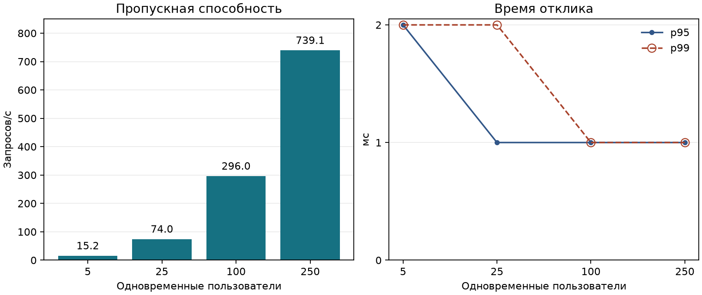

# Нагрузочное тестирование API задач в Apache JMeter

## Сценарий

В [tasks-api.jmx](tasks-api.jmx) один поток JMeter моделирует одного пользователя. Каждый цикл начинается с `GET /api/tasks` со случайными `status` (`OPEN` или `DONE`), размером страницы (5, 10 или 20) и смещением (0–40). Следующий запрос открывает карточку по ID из ответа. В 25% циклов пользователь также создаёт задачу с уникальным заголовком, переводит её в `DONE` и перечитывает после обновления. Между запросами случайная пауза примерно 150–500 мс.

Проверки учитывают HTTP-код и JSON. Для списка проверяются размер, фильтр по статусу, порядок и уникальность ID. Карточка сверяется с результатом списка. Для создания проверяются `201`, заголовок `Location`, поля и ID. Обновление и повторное чтение должны вернуть тот же ID, новый заголовок и статус `DONE`. Ошибка HTTP, тайм-аут или несоответствие в проверке отмечают запрос как неуспешный.

Отдельно проверил срабатывание проверки: в копии плана завысил ожидаемый размер страницы на одну запись. JMeter пометил все 53 ответа HTTP 200 как ошибки проверки.

## Методика

Замеры выполнены 21 ноября 2026 года на локальном стенде. API запускается с профилем `jmeter` в Spring Boot 3.5.9 и хранит 10 000 начальных задач и новые записи в памяти. JMeter 5.6.3 и приложение работали на одной машине под Java 21. Пробный прогон принудительно включал запись во всех циклах. После 15-секундного прогрева выполнил четыре последовательных прогона по 25 с с разгоном 4 с.

Для сопоставимых значений взял 18-секундное окно через 5 с от первого запроса и проверил число активных потоков по JTL. Пропускная способность — число запросов, начатых в этом окне, делённое на 18 с. Время отклика — `elapsed` из JMeter, в миллисекундах, без паузы между запросами. p95 и p99 рассчитаны по методу ближайшего ранга. Ошибки проверены и в окнах, и за полные прогоны, включая разгон.

## Результаты

| Пользователи | Запросов в окне | Запросов/с | p95, мс | p99, мс | Ошибки за весь прогон |
| ---: | ---: | ---: | ---: | ---: | ---: |
| 5 | 274 | 15,22 | 2 | 2 | 0 из 355 |
| 25 | 1 332 | 74,00 | 1 | 2 | 0 из 1 707 |
| 100 | 5 328 | 296,00 | 1 | 1 | 0 из 6 821 |
| 250 | 13 303 | 739,06 | 1 | 1 | 0 из 17 054 |

| Операция | p95 при 5, мс | p95 при 25, мс | p95 при 100, мс | p95 при 250, мс | Максимум при 250, мс |
| --- | ---: | ---: | ---: | ---: | ---: |
| GET список | 2 | 1 | 1 | 1 | 2 |
| GET карточка | 2 | 1 | 1 | 1 | 6 |
| POST создание | 2 | 2 | 1 | 1 | 3 |
| PUT обновление | 2 | 1 | 1 | 1 | 2 |
| GET после обновления | 2 | 1 | 1 | 1 | 6 |



[Сводка по операциям](evidence/summary.csv) содержит среднее, медиану, p95, p99, максимум, скорость и ошибки. Исходные результаты в JTL сохранены для [5](evidence/users-5.jtl.gz), [25](evidence/users-25.jtl.gz), [100](evidence/users-100.jtl.gz) и [250 пользователей](evidence/users-250.jtl.gz).

## Вывод

При росте нагрузки с 5 до 250 пользователей пропускная способность выросла с **15,22 до 739,06 запроса/с**, почти пропорционально числу пользователей. Все **25 937** запросов в четырёх прогонах прошли проверки. После последнего прогона Actuator вернул `UP`. p95 ключевых операций оставался в пределах **1–2 мс**. Разница в 1 мс сопоставима с разрешением измерения, а последовательный порядок прогонов мог повлиять на прогрев JVM.

На проверенном диапазоне устойчивого роста задержек или конкретного кандидата на оптимизацию не выявлено. Этот результат относится к коротким прогонам через loopback с хранением в памяти. Для оценки рабочих пределов сервиса нужен более длительный прогон с реальным хранилищем, сетевой задержкой и наблюдением за CPU, GC и пулом подключений.

## Воспроизведение

Из каталога `application_performance_management` соберите и запустите стенд с JDK 21.

```bash
mvn -B verify
java -jar target/application-performance-management-1.0.0.jar \
  --spring.profiles.active=jmeter --server.address=127.0.0.1 --server.port=18081
```

В другом терминале укажите установленный JMeter 5.6.3 в `PATH` и выберите новый каталог для результатов.

```bash
RUN=$(mktemp -d "$PWD/target/jmeter-run.XXXXXX")
jmeter -n -t jmeter/tasks-api.jmx -l "$RUN/warmup.jtl" -j "$RUN/warmup.log" \
  -Jthreads=25 -Jramp=4 -Jduration=15

for users in 5 25 100 250; do
  jmeter -n -t jmeter/tasks-api.jmx \
    -l "$RUN/users-$users.jtl" -j "$RUN/users-$users.log" \
    -Jthreads="$users" -Jramp=4 -Jduration=25
done

python3 jmeter/summarize.py "$RUN"/users-*.jtl > "$RUN/summary.csv"
```

Параметры плана также позволяют изменить `host`, `port`, `protocol`, долю циклов записи `write_percent` и паузу `think_ms` + `jitter_ms`. Для отчёта JMeter в HTML можно передать файл `users-250.jtl` через `jmeter -g` и указать пустой выходной каталог через `-o`. [Руководство JMeter по запуску из командной строки](https://jmeter.apache.org/usermanual/get-started.html#non_gui)
