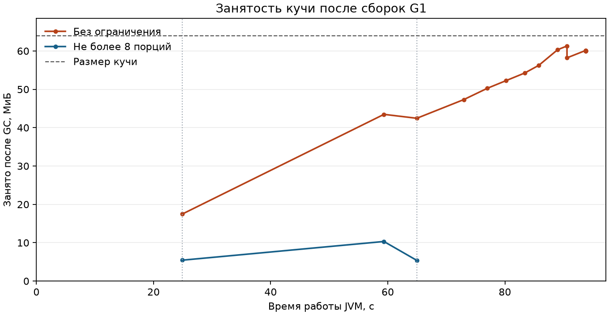

# Анализ GC и утечки памяти в Java

При лимите кучи 64 МиБ приложение со статической коллекцией завершилось с `OutOfMemoryError: Java heap space` примерно через **94 секунды**. Контрольный режим с ограничением коллекции обработал все 125 порций. После двух полных сборок в нём оставалось около **5,4 МиБ**.

## 1. Проведение эксперимента

1. **Включил GC-логирование.** Запустил два отдельных процесса Amazon Corretto 21.0.13.1 с G1 и одинаковыми параметрами `-Xms64m -Xmx64m`. Флаг `-Xlog:gc*,gc+heap=debug:file=gc.log:uptime,level,tags:filecount=0` сохраняет события GC, время от запуска JVM и заполнение кучи. В скрипте каждый процесс пишет в свой `gc.log`. Флаги `-XX:+HeapDumpOnOutOfMemoryError` и `-XX:HeapDumpPath=...` сохраняют снимок при исчерпании кучи. [Параметры запуска JVM](https://docs.oracle.com/en/java/javase/21/docs/specs/man/java.html)
2. **Создал два платформенных потока.** В [MemoryPressure.java](MemoryPressure.java) фиксированный пул выполняет две задачи на порцию. В каждой задаче `IntStream.range(...).mapToObj(...).toList()` создаёт четыре объекта `Payload` с массивами по 64 КиБ. Главный поток дожидается обеих задач, объединяет их результаты и добавляет порцию в статическую `ArrayDeque`.
3. **Запустил нагрузку.** Каждый процесс выделяет по 512 КиБ полезных данных за порцию с паузой 800 мс, то есть примерно 0,625 МиБ/с. В режиме `leak` коллекция сохраняет все порции. В `bounded` она сохраняет только восемь последних — 64 объекта с 4 МиБ полезных данных.
4. **Снял дампы.** После 32-й и 82-й порций приложение вызывает `HotSpotDiagnosticMXBean.dumpHeap(..., true)`. В HPROF попадают живые объекты, а в GC-логе появляется `Pause Full (Heap Dump Initiated GC)`. В режиме `leak` JVM дополнительно создала `oom.hprof` при ошибке выделения памяти. [API HotSpotDiagnosticMXBean](https://docs.oracle.com/en/java/javase/21/docs/api/jdk.management/com/sun/management/HotSpotDiagnosticMXBean.html#dumpHeap(java.lang.String,boolean))

## 2. Что показал GC-лог

По идентификатору `GC(n)` сопоставил строки `Heap before GC` и `Heap after GC`. Значение `used` записано в КиБ. Для таблицы перевёл его в МиБ. Для сравнения режимов взял одинаковые точки — две полные сборки при снятии дампов. [Лог утечки](evidence/leak/gc.log), [лог контрольного режима](evidence/bounded/gc.log).

| Режим | Событие | Время JVM, с | Занято до → после GC, МиБ |
| --- | --- | ---: | ---: |
| Утечка | Первый дамп, `GC(0)` | 24,911 | 19,05 → 17,47 |
| Утечка | Второй дамп, `GC(2)` | 64,959 | 46,47 → 42,45 |
| Утечка | Последняя компактизация, `GC(20)` | 93,822 | 60,04 → 60,04 |
| Ограничение | Первый дамп, `GC(0)` | 24,907 | 19,05 → 5,44 |
| Ограничение | Второй дамп, `GC(2)` | 64,947 | 13,32 → 5,40 |

GC освобождал временные объекты в обоих режимах. При утечке занятость кучи **после** полной сборки выросла с 17,47 до 42,45 МиБ. Вблизи ошибки G1 несколько раз запускал полную компактизацию. Последняя оставила те же 61 485 КиБ, после чего JVM сообщила об исчерпании кучи. При ограниченной коллекции занятость после полных сборок оставалась около 5,4 МиБ, и процесс завершился за 99,3 с. [Вывод при утечке](evidence/leak/application.log), [вывод контрольного прогона](evidence/bounded/application.log), [коды завершения](evidence/status.txt).



На графике каждая точка соответствует завершившейся сборке, а вертикальные пунктиры отмечают снятие дампов. График построен по GC-логам с помощью [plot_gc.py](plot_gc.py) и Matplotlib.

## 3. Анализ дампов в Eclipse MAT

В Eclipse MAT 1.17.0 запустил **Leak Suspects** для `late.hprof`, сравнил его с `early.hprof` и просмотрел **Histogram** контрольного и аварийного дампов. MAT показал, что в режиме утечки число объектов `MemoryPressure$Payload` выросло с **256 до 656**. В контрольном дампе было **64** таких объекта, в аварийном — **938**. [Сравнение дампов](evidence/mat-leak-suspects-delta.zip), [Histogram контрольного режима](evidence/mat-bounded-histogram.zip), [Histogram аварийного дампа](evidence/mat-oom-histogram.zip).

В отчёте **Leak Suspects → Shortest Paths To the Accumulation Point** открыл цепочку ссылок от класса `MemoryPressure` к массиву `ArrayDeque.elements` через статическое поле `RETAINED_BATCHES`. В **Dominator Tree** этот массив удерживал **42 494 360 байт** (около 40,53 МиБ, 96% учтённой кучи) вместе с порциями и их массивами. **Shallow Heap** показывает размер самого объекта, а **Retained Heap** — сколько памяти освободилось бы вместе с объектами, которые он удерживает. Путь к GC root объясняет, почему эти объекты переживали сборки. [Отчёт Leak Suspects](evidence/mat-leak-suspects.zip), [руководство Eclipse MAT](https://help.eclipse.org/latest/topic/org.eclipse.mat.ui.help/gettingstarted/basictutorial.html).

## 4. Выводы и устранение

Причиной роста кучи была статическая коллекция с неограниченным сроком хранения объектов. Потоки и Stream API создавали одинаковую нагрузку в обоих режимах. Ограничение коллекции восемью порциями разорвало сильные ссылки на старые данные, после чего G1 смог их освобождать. Для реального кеша предел стоит выбирать по объёму данных и необходимому времени хранения. Если данные нужны до конца обработки порции, достаточно локальной коллекции. Увеличение `-Xmx` при сохранении прежней логики только отсрочит исчерпание памяти.

## Воспроизведение

В каталоге `application_performance_management` запустите скрипт с JDK 21 в `JAVA_HOME` или `PATH`.

```bash
./memory/run.sh
```

Скрипт выводит путь к новому каталогу в `target/`. Внутри находятся `leak/gc.log`, `bounded/gc.log`, по два снимка `early.hprof` и `late.hprof`, а также `leak/oom.hprof`. Укажите путь из вывода скрипта в `RUN`, каталог установки MAT в `MAT` и путь к Java 21 в `MAT_JAVA`.

```bash
RUN="$PWD/target/memory.XXXXXX"
MAT=/path/to/mat
MAT_JAVA=/path/to/jdk-21/bin/java
export JAVA_TOOL_OPTIONS=-Djava.awt.headless=true

"$MAT/ParseHeapDump.sh" "$RUN/leak/late.hprof" org.eclipse.mat.api:suspects -vm "$MAT_JAVA"
"$MAT/ParseHeapDump.sh" "$RUN/leak/late.hprof" \
  "-baseline=$RUN/leak/early.hprof" org.eclipse.mat.api:suspects2 -vm "$MAT_JAVA"
"$MAT/ParseHeapDump.sh" "$RUN/bounded/late.hprof" \
  -command=histogram org.eclipse.mat.api:query -vm "$MAT_JAVA"
"$MAT/ParseHeapDump.sh" "$RUN/leak/oom.hprof" \
  -command=histogram org.eclipse.mat.api:query -vm "$MAT_JAVA"
```

Распакуйте полученные ZIP-архивы и откройте `index.html` в каждом. [Пакетный режим Eclipse MAT](https://help.eclipse.org/latest/topic/org.eclipse.mat.ui.help/tasks/batch.html)
