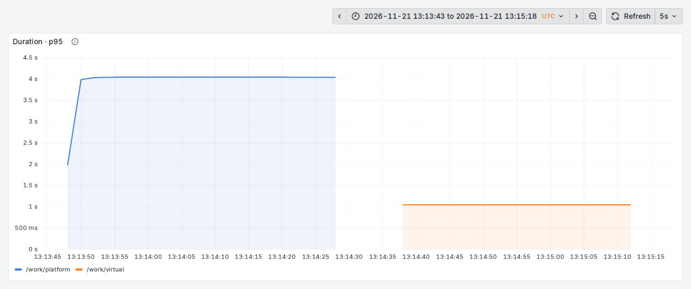
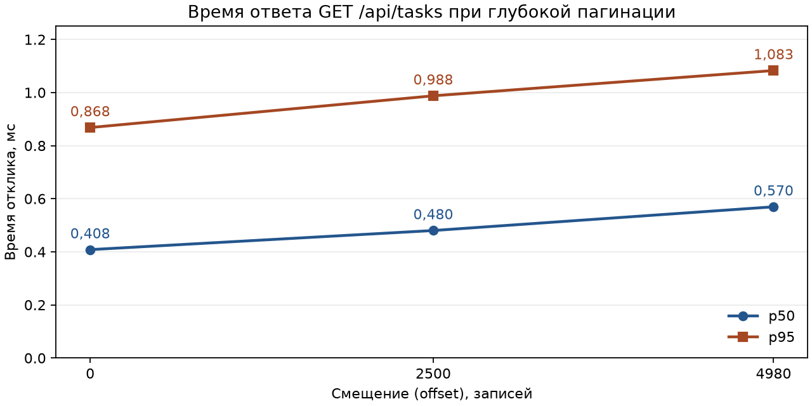
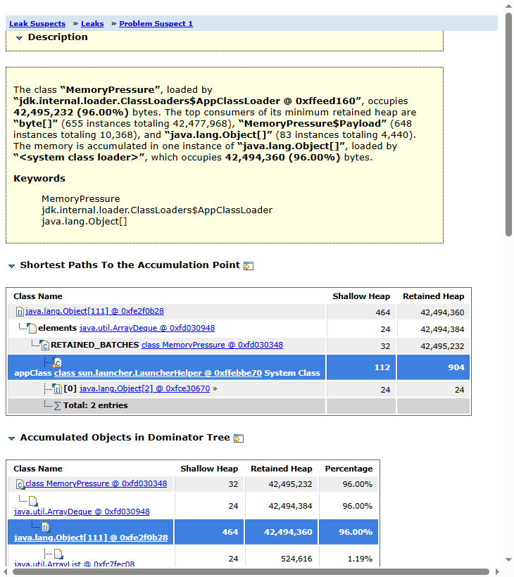

# Анализ рисков производительности

## Проект

Это учебный REST-сервис для измерения производительности HTTP-запросов и работы JVM. В профиле `jmeter` он обрабатывает задачи с ID, заголовком и статусом: выдаёт списки и карточки, создаёт и обновляет записи. Маршруты `/work/platform` и `/work/virtual` имитируют секундное ожидание ответа внешнего сервиса. Отдельная программа `MemoryPressure` воспроизводит удержание объектов в куче.

Сервер — **монолит** на Java 21, Spring Boot и Spring MVC. Оба контроллера работают в одном JVM-процессе, задачи хранятся в потокобезопасной карте в памяти. Spring Boot Actuator и Micrometer отдают метрики, а Prometheus и Grafana собирают и визуализируют их. Для нагрузочных тестов использован JMeter, для анализа дампов — Eclipse MAT. Наиболее затратные операции в текущем проекте — обход большого списка при пагинации, удержание рабочих потоков во время ожидания и сборка мусора при росте числа живых объектов. [Код сервера](../src/main/java/edu/study/apm/), [отчёт JMeter](../jmeter/REPORT.md).

## 1. Контекстное переключение и насыщение пула

**Как проявилось.** Платформенный исполнитель использует 16 рабочих потоков и очередь на 256 задач. В повторной проверке 64 одновременных запроса к `/work/platform` дали **16 активных задач и 48 в очереди** по метрикам Actuator. В исходном сравнении Grafana оценила p95 примерно в **4,05 с** для платформенного метода и **1,05 с** для виртуального. Оба выполняли секундное ожидание. [Показания Actuator](evidence/platform-executor.json), [методика замера](../REPORT_THROUGHPUT.md).

**Почему это важно.** Очередь уже увеличивает задержку под параллельной нагрузкой. Фиксированный пул ограничивает число одновременно выполняемых и ожидающих задач. Поэтому риск неограниченного создания платформенных потоков, характерный для `newCachedThreadPool()`, здесь невелик. Увеличение пула потребует больше памяти на стеки и может добавить переключения при конкуренции за CPU. В проведённом эксперименте подтверждено насыщение пула. Частоту переключений ОС отдельно не измеряли. [Настройки пула](../src/main/java/edu/study/apm/Application.java).

**Как обнаружить и предотвратить.** При ступенчатой нагрузке сопоставлять `executor.active`, `executor.queued` и p95 `http.server.requests` для нужного маршрута. На Linux команда `pidstat -w -t -p <PID> 1` покажет добровольные и принудительные переключения по потокам. Для работы с блокирующим I/O можно использовать виртуальные потоки и ограничить число операций у самого узкого ресурса, например семафором перед внешним API. Для платформенного пула стоит ограничить время ожидания в очереди и возвращать `503` при её насыщении. [Руководство pidstat](https://github.com/sysstat/sysstat/blob/master/man/pidstat.1), [виртуальные потоки в Java 21](https://docs.oracle.com/en/java/javase/21/core/virtual-threads.html).

## 2. Алгоритмический уровень

**Как проявилось.** `GET /api/tasks` проходит по значениям `ConcurrentSkipListMap` в порядке ID, фильтрует их по статусу и применяет `skip(offset)`, затем `limit(limit)`. Пропуск записей требует обхода предыдущих совпадений. На 10 000 исходных задачах для 20 открытых записей первая страница проверяет 40 элементов, а страница со смещением 4 980 проходит весь набор. При росте смещения или редком статусе обход может занять линейное время от размера набора. Чтение карточки по ID использует поиск по ключу со средним ожидаемым временем порядка `O(log N)`. [Код пагинации](../src/main/java/edu/study/apm/TaskController.java), [ConcurrentSkipListMap в Java 21](https://docs.oracle.com/en/java/javase/21/docs/api/java.base/java/util/concurrent/ConcurrentSkipListMap.html).

После 200 раундов прогрева выполнил по 1 600 запросов на каждое смещение через локальный HTTP. В каждом раунде порядок трёх смещений перемешивался. Статус `OPEN` и размер страницы 20 оставались одинаковыми. Клиент проверял HTTP 200 и все ID, а время измерял до получения полного ответа. [Исходные замеры](evidence/offset-timings.csv).

**Почему это важно.** Для самой глубокой страницы p95 вырос с **0,868 до 1,083 мс**. Разница мала для одиночного локального запроса, но больший объём обхода будет повторяться для каждого клиента. Прежний прогон JMeter использовал смещения 0–40, поэтому его стабильные задержки характеризуют преимущественно начало списка. [Параметры сценария JMeter](../jmeter/REPORT.md).

**Как обнаружить и предотвратить.** В JMeter выделить отдельные сценарии для первой, средней и глубокой страниц с фиксированным размером результата. Повторить их на наборах разного размера и сравнить p95 и загрузку CPU. Для серверной диагностики измерить просмотренные элементы и время фильтрации в Micrometer, избегая отдельных серий метрик для каждого значения `offset`. Для последовательного просмотра перейти на курсор `afterId` и начинать проход через `tailMap(afterId, false)`. Если нужные статусы встречаются редко, использовать индекс по `(status, id)` и обновлять его согласованно с изменением статуса. Результат оптимизации проверить тем же профилем нагрузки.

## 3. Среда выполнения JVM

**Как проявилось.** В отдельном эксперименте `MemoryPressure` с G1 и кучей 64 МиБ удерживаемые порции оставались достижимыми через статическую коллекцию. После полных GC занятость выросла с **17,47 до 42,45 МиБ**, а примерно через **94 с** процесс завершился с `OutOfMemoryError`. Контрольный режим хранил только восемь порций и после полных сборок оставлял около **5,4 МиБ**. Снимок Eclipse MAT указывает на `RETAINED_BATCHES` и массив `ArrayDeque.elements`, удерживающий примерно 40,53 МиБ. [GC-логи и полный разбор](../memory/REPORT.md), [выгрузка Eclipse MAT](../memory/evidence/mat-leak-suspects.zip).

**Почему это важно.** В профиле `jmeter` каждый POST тоже увеличивает число живых записей в карте, а PUT заменяет запись по существующему ID. При длительной нагрузке с высокой долей POST рабочий набор будет расти, пока данные остаются в памяти. Исчерпание кучи подтверждено для отдельной программы с искусственной утечкой. Короткие прогоны REST API завершились штатно. [Код хранения задач](../src/main/java/edu/study/apm/TaskController.java), [результаты JMeter](../jmeter/REPORT.md).

**Как обнаружить и предотвратить.** На длительном тесте записи сравнивать число задач с `jvm.memory.used` для heap, `jvm.gc.live.data.size` после сборок старого поколения и длительностью `jvm.gc.pause`. При росте занятости после GC снять два дампа и сравнить удерживаемые объекты в Eclipse MAT или VisualVM. Для лабораторной утечки уже проверено ограничение коллекции. Для задач с длительным сроком жизни стоит держать основную копию в постоянном хранилище и ограничивать объём кеша. При развёртывании в контейнере проверить лимит памяти и оставить запас сверх `-Xmx` для стеков, метаданных и другой нативной памяти JVM. [Метрики JVM в Micrometer](https://docs.micrometer.io/micrometer/reference/reference/jvm.html), [диагностика утечек JVM](https://docs.oracle.com/en/java/javase/21/troubleshoot/troubleshooting-memory-leaks.html).
