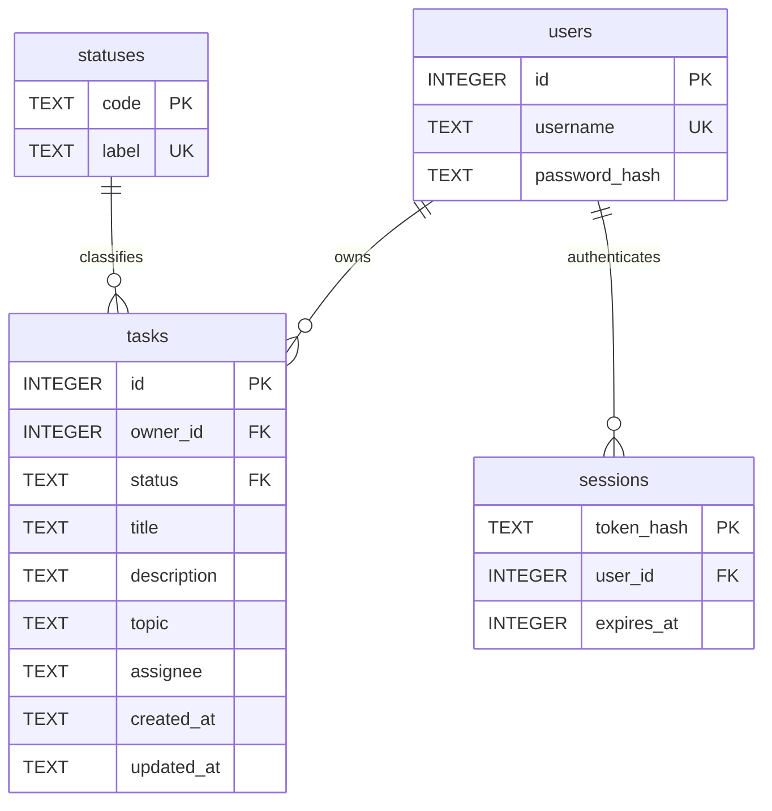

# Трекер задач

Персональный список задач с фильтрами и отчётами. FastAPI обрабатывает HTTP-запросы, SQLite хранит данные, pandas вычисляет статистику, matplotlib строит PNG. [Мини-презентация проекта (PDF, 4 слайда)](docs/task-tracker.pdf).

## Запуск

Из каталога `task_tracker/`, с Python 3.12–3.14, SQLite 3.35+ и uv:

```sh
uv sync --frozen
uv run uvicorn tracker.main:app --host 127.0.0.1 --port 8000
```

Откройте [Swagger UI](http://127.0.0.1:8000/docs). Выполните `POST /auth/register`, затем `POST /auth/login` с теми же полями `username` и `password` (от 8 символов). Скопируйте значение `access_token` в **Authorize**. Теперь запросы из Swagger UI будут выполняться от вашего имени.

При первом запуске сервис создаёт файл `data/tracker.sqlite3`. Чтобы выбрать другой путь, задайте переменную окружения `TRACKER_DB` перед запуском. Все временные метки задач записываются в UTC.

## Пример работы

После входа создайте задачу через `POST /tasks`:

```json
{
  "title": "Проверить фильтры",
  "topic": "API",
  "assignee": "Анна"
}
```

Ответ содержит `id` и статус `new`. Подставьте полученный идентификатор в `PATCH /tasks/{id}` и отправьте `{"status":"done"}`. Затем откройте `GET /analytics?topic=API&group_by=assignee`. Если это единственная задача по теме, отчёт покажет:

```json
{
  "group_by": "assignee",
  "total": 1,
  "done": 1,
  "completion_percent": 100.0,
  "groups": [{"value": "Анна", "count": 1}]
}
```

### Маршруты

| Метод и путь | Результат |
| --- | --- |
| POST /auth/register · POST /auth/login | Создать учётную запись · получить токен |
| POST /auth/logout | Отозвать текущий токен, 204 |
| GET /statuses | Коды и русские названия статусов |
| POST /tasks | Создать задачу, 201 |
| GET /tasks | Задачи от новых к старым по ID, по умолчанию 50 записей |
| GET /tasks/{id} | Получить задачу |
| PATCH /tasks/{id} | Изменить переданные поля, включая статус. `null` очищает тему или исполнителя |
| DELETE /tasks/{id} | Удалить задачу, 204 |
| GET /analytics | Сводка и размеры групп в JSON |
| GET /analytics/chart.png | Горизонтальная столбчатая диаграмма в PNG |

Для списка и обоих отчётов доступны совместимые фильтры точного совпадения `status`, `topic`, `assignee`. Список принимает `limit` (1–100) и `offset`. Отчёты учитывают **всю** отфильтрованную выборку. Параметр `group_by` принимает `status` (по умолчанию), `topic` или `assignee`. Пустые темы и исполнители образуют отдельные группы со значением `null`. Сводка возвращает все представленные группы, диаграмма показывает до 12 самых многочисленных. Доля выполнения равна числу задач в статусе `done`, делённому на размер выборки, в процентах. Для пустой выборки она равна нулю.

## Модель данных



У каждой задачи ровно один владелец и один статус. Допустимы `new` (новая), `in_progress` (в работе), `done` (сделано) и `blocked` (заблокирована). Владелец может переключать их в любом порядке. Тема и исполнитель — необязательные текстовые метки. Назначение исполнителя не предоставляет доступ к задаче. У пользователя может быть несколько активных сессий. При удалении пользователя из БД внешний ключ каскадно удаляет его задачи и сессии.

## Миграции

1. [001_core.sql](tracker/migrations/001_core.sql) создаёт четыре таблицы, ограничения, внешние ключи и начальный справочник статусов.
2. [002_indexes.sql](tracker/migrations/002_indexes.sql) добавляет индексы для списка задач владельца, трёх фильтров и поиска истёкших сессий.

При старте приложение берёт блокировку записи SQLite, читает `PRAGMA user_version` и применяет недостающие версии в одной транзакции. Ошибка откатывает изменения. Повторный запуск сохраняет данные. Можно применить миграции отдельно через `uv run python -m tracker.db`. Для следующего обновления добавьте SQL-файл с очередным числовым префиксом в `tracker/migrations/`. Для восстановления прежней версии сохраните резервную копию базы перед обновлением.

## Доступ и защита данных

Пароли хешируются Argon2id. Для каждой сессии генерируется случайный Bearer-токен на 24 часа. База хранит его SHA-256 и срок действия в секундах Unix. Клиент передаёт токен в заголовке `Authorization: Bearer <token>`. Неверный или истёкший токен даёт 401. Сервер ограничивает чтение, изменение, удаление и аналитику идентификатором владельца из сессии. Запрос чужой или отсутствующей задачи возвращает 404.

Значения в SQL передаются отдельными параметрами `?`. В динамических частях запросов имена колонок определяет схема приложения. Неизвестные поля записи отклоняются с 422. Для передачи паролей и токенов за пределами локального компьютера используйте HTTPS.

## Проверка

```sh
uv run --frozen ruff check .
uv run --frozen ruff format --check .
uv run --frozen pytest -q
```

Тесты используют временные базы и проверяют CRUD, фильтрацию, страницы списка, валидацию, метасимволы SQL, изоляцию владельцев, срок действия и отзыв сессий, группировки, PNG и обновление старой схемы.
